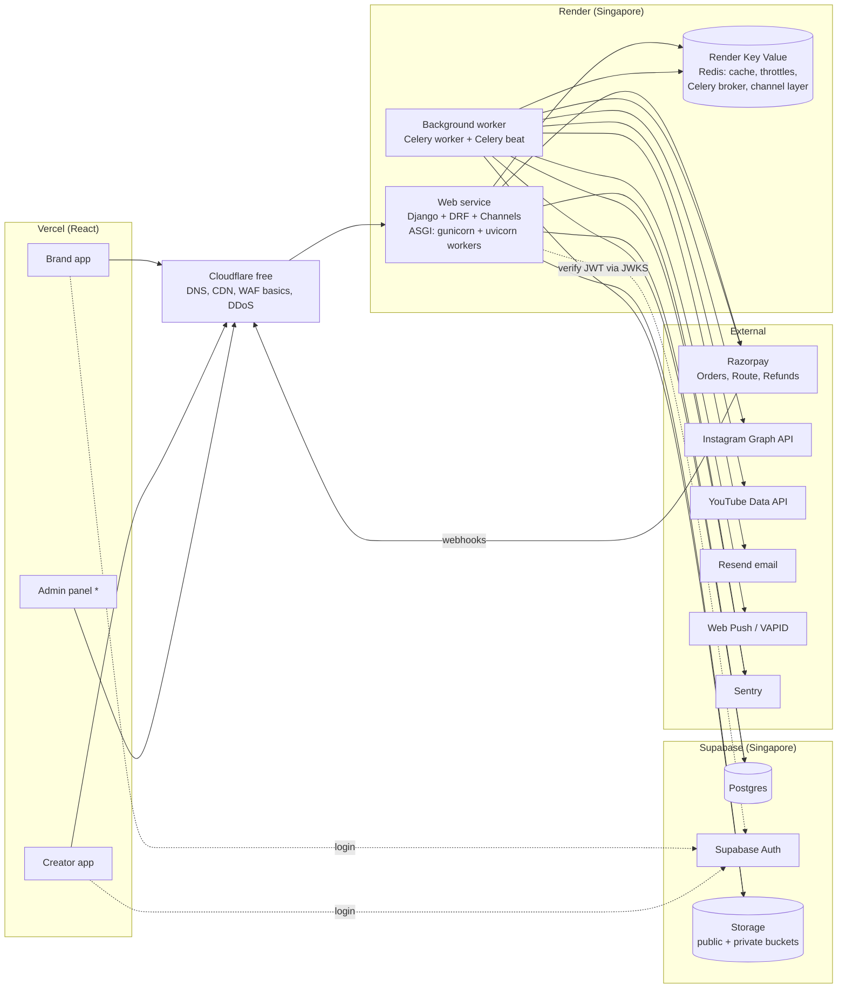

# 01 — Architecture

## 1. Goals

| Goal | What it means in practice |
|------|---------------------------|
| **Secure by default** | Money and PII are protected by design, not by reviewer vigilance. Authz is centralized and tested. |
| **Correct money** | Never lose, double-charge, or double-pay. Ledger plus reconciliation. |
| **Scale without rewrite** | Stateless API, horizontal scaling, queues for slow work, clear app boundaries so services can be split later. |
| **Fast and cheap to build** | Small team, free tiers while building, small paid upgrades only when they're needed (see §8). |
| **India-first** | INR, GST/TDS, DPDP Act 2023 compliance, low latency for Indian users. |

**Non-goals for v1:** microservices, multi-region, multi-currency, native mobile-specific APIs.

## 2. Key decision: modular monolith (one Django project)

One Django project serves the HTTP API (DRF) and WebSockets (Django Channels). A Celery worker runs from the same codebase. Internally it is split into **Django apps with hard boundaries** (see [02-system-design.md](02-system-design.md)).

Why not microservices? With ~82 endpoints and a small team, microservices add network failures, distributed transactions (deadly for escrow), and ops cost, without benefit at our scale. App boundaries let us extract a service later if load proves we need it.

App boundary rules:
- Each app exposes a `services.py` (write operations) and a `selectors.py` (read queries). Other apps call those, **never another app's models or querysets directly**.
- Cross-app side effects go through **domain events** (outbox → Celery), not direct calls.
- `import-linter` contracts enforce the import rules in CI.
- Views stay thin: parse with a serializer → call a service → return a serializer. **No business logic in views, serializers, or model `save()`.**

## 3. System context



\* **Admin panel:** for v1 we use the **Django admin** (hardened, with 2FA). It's free, quick, and good enough for ops: approvals, disputes, refunds, payouts. A custom React admin can come later. See ADR-011.

**Region:** the Supabase project is in **Mumbai (ap-south-1)**. Render has no India region; its closest is **Singapore**, which adds about 60 ms to each API→DB round trip. That's acceptable for v1. Keep queries per request low, and move the API to Mumbai (e.g. AWS ap-south-1) when latency matters. That's a migration, not a rewrite. Under the DPDP Act, general personal data can currently be stored outside India (excluding blacklisted countries); payment-data localization is Razorpay's obligation. Re-check this with counsel before launch.

## 4. Tech stack

| Concern | Choice | Why |
|---------|--------|-----|
| Language | **Python 3.13** | Team's stack. Type hints + mypy (`django-stubs`) |
| Framework | **Django 5.2 LTS + Django REST Framework** | Mature, secure defaults, ORM, migrations, admin |
| Package mgmt | **uv** (`pyproject.toml` + lockfile) | Fast, reproducible installs |
| ASGI server | **gunicorn + uvicorn workers** | Serves HTTP and WebSockets in one service |
| DB | **Postgres** on Supabase | Transactions and row locks for money; JSONB; full-text search |
| ORM | **Django ORM** | `transaction.atomic`, `select_for_update`, DB-level `UniqueConstraint`/`CheckConstraint` |
| App-user identity | **Supabase Auth** (email OTP, Google; MFA available) | We never store passwords; DRF verifies JWTs |
| Staff identity | **Django auth + `django-otp`** (TOTP) for the Django admin | Separate from app users; 2FA mandatory |
| Validation | **DRF serializers**, with a base class that **rejects unknown fields** | DRF silently ignores unknown fields by default, which hides mass-assignment bugs |
| API schema | **drf-spectacular** (OpenAPI 3) → `openapi-typescript` client for React | Frontends get typed, generated API calls |
| Background jobs | **Celery + Redis**, **Celery beat** for cron | Standard and proven |
| Realtime | **Django Channels** + `channels-redis` | WebSocket messaging and live notifications |
| Cache / throttles | Redis via `django-redis` | DRF throttling, caching |
| Storage | Supabase Storage (S3-compatible) via `django-storages` / `boto3`, **presigned uploads** | Files never stream through the API |
| Payments | **Razorpay** Python SDK, Orders + **Route** | Escrow-style holds plus split payouts |
| Images | Pillow (re-encode, strip EXIF) | Upload safety |
| PDFs | WeasyPrint or ReportLab (in Celery) | GST invoices, TDS statements |
| Encryption | `cryptography` AES-GCM | Social tokens, PAN |
| Email | **Resend** (free tier) | Transactional email |
| Errors / logs | **Sentry** (free tier) + `structlog` JSON logs | |
| Quality | ruff, mypy, pytest, pytest-django, factory_boy, coverage, Bandit, pip-audit, Semgrep, import-linter | |
| Frontends | React on **Vercel** | Separate projects: brand, creator (and later admin) |
| CI/CD | GitHub Actions → Render auto-deploy | |

## 5. Repository layout

```
collab/
├── backend/
│   ├── pyproject.toml / uv.lock
│   ├── manage.py
│   ├── config/
│   │   ├── settings/ (base.py, local.py, test.py, production.py)
│   │   ├── urls.py   asgi.py   wsgi.py   celery.py
│   ├── apps/
│   │   ├── core/          # base model (UUIDv7, timestamps), exceptions, envelope renderer,
│   │   │                  # pagination, throttles, idempotency, outbox, crypto, strict serializer
│   │   ├── identity/      # User model, Supabase JWT auth class, roles, admin CLI, audit log
│   │   ├── creators/      # profiles, media, packages, social accounts, payout accounts
│   │   ├── brands/        # brand profile, lists, cart
│   │   ├── discovery/     # search & filters (read-only selectors)
│   │   ├── campaigns/     # campaigns, bids
│   │   ├── offers/
│   │   ├── orders/        # orders, state machine, deliverables, revisions, disputes
│   │   ├── payments/      # razorpay client, escrow, ledger, refunds, payouts, webhooks
│   │   ├── money/         # pure fee/GST/TDS math (no Django imports), 100% tested
│   │   ├── tax/           # invoices, TDS records, PDFs
│   │   ├── reviews/
│   │   ├── messaging/     # conversations, messages, Channels consumers
│   │   ├── notifications/ # in-app, email, web push
│   │   ├── reporting/     # dashboards
│   │   └── ops/           # admin APIs + Django admin customizations
│   └── tests/             # cross-app integration & authz-matrix tests
├── docs/                  # you are here
├── .env.example
└── .github/workflows/
```

Each app has the same shape: `models.py`, `services.py`, `selectors.py`, `policies.py`, `serializers.py`, `views.py`, `urls.py`, `tasks.py`, `admin.py`, `tests/`.

The React apps live in their own repos/Vercel projects and consume the generated OpenAPI client.

## 6. Request lifecycle (HTTP)

```
Cloudflare (DDoS, basic WAF)
  → Render → gunicorn/uvicorn → Django
  → SecurityMiddleware (HSTS, nosniff), django-cors-headers (allowlist)
  → RequestIdMiddleware (+ Sentry/structlog context)
  → DATA_UPLOAD_MAX_MEMORY_SIZE = 1 MB (uploads never hit the API)
  → DRF authentication: SupabaseJWTAuthentication
      verify JWT via JWKS (sig, iss, aud, exp) → load User from OUR DB → reject if not active
  → DRF permissions: IsBrand / IsCreator / IsAdminRole (+ object-level policy)
  → DRF throttles: per-user / per-scope (Redis)
  → StrictSerializer validation (unknown fields → 400)
  → View → service (policy check via scoped queryset → logic in transaction.atomic → outbox)
  → Output serializer (explicit fields only)
  → EnvelopeRenderer { success, data, error, meta }
  → Custom exception handler (safe message + code + requestId; details to Sentry)
```

## 7. Event flow (transactional outbox)

All side effects (notifications, emails, WS pushes, payout releases) are driven by **domain events** written to an `OutboxEvent` row **in the same `transaction.atomic()` block** as the state change. A Celery beat task (every few seconds) relays unpublished events to Celery queues. Consumers are idempotent.

```mermaid
sequenceDiagram
  participant API as Django service
  participant PG as Postgres
  participant Beat as Celery beat: relay_outbox
  participant Wk as Celery worker
  API->>PG: atomic: update order; insert OutboxEvent(order.draft_submitted)
  Beat->>PG: select_for_update(skip_locked=True) unpublished batch
  Beat->>Wk: send_task(handler, event_id)
  Beat->>PG: mark published
  Wk->>PG: insert Notification (unique on event_id + user)
  Wk-->>Wk: email / web push / channel_layer.group_send → WS
```

> Why not just `transaction.on_commit(lambda: task.delay(...))`? If the process dies right after commit, the task is lost. The outbox survives crashes. `on_commit` is fine for non-critical things like cache invalidation.

## 8. Deployment and free-tier reality

| Piece | Free-tier option | Limits that matter | When to pay |
|-------|------------------|--------------------|-------------|
| React apps | Vercel Hobby | Hobby is for **personal, non-commercial** use | **Vercel Pro** before public launch |
| Django web service | Render free web service | **Spins down after ~15 min idle, ~1 min cold start**; WebSockets drop; limited free hours | Starter instance before real users |
| Celery worker + beat | **None:** Render has no free background workers | Without a worker, no emails, notifications, payouts, auto-approve, or reconciliation | **First paid item.** Needed as soon as Phase 1 notifications exist |
| Redis | Render Key Value free | Small memory, **no persistence** (queued jobs lost on restart; outbox makes this safe) | Paid with persistence before payments go live |
| Postgres + Storage | Supabase free | Project **pauses after ~1 week idle**, small DB/storage limits, **no automatic backups/PITR** | **Supabase Pro before any real money or real user data** |
| Email | Resend free | Low daily/monthly caps | When volume grows |
| Errors | Sentry free | Event quota | Later |
| Edge | Cloudflare free | Fine for v1 | Later |

(Free-tier limits change. Verify on each provider's pricing page.)

**Recommendation:** use free tiers for **local dev and staging**. **Production with payments must not run on free tiers.** A sleeping API delays Razorpay webhooks, a non-persistent Redis without a worker breaks payouts, and having no DB backups means one bad migration could lose money records. The minimum launch upgrade is: Render starter (web + worker), persistent Redis, Supabase Pro, Vercel Pro.

| Service | Render type | Start command |
|---------|-------------|---------------|
| `api` | Web Service | `gunicorn config.asgi:application -k uvicorn.workers.UvicornWorker` |
| `worker` | Background Worker | `celery -A config worker -l info` |
| `beat` | runs inside worker (`-B`) on a single instance, or as its own worker | `celery -A config beat` |
| migrations | Pre-deploy command | `python manage.py migrate --noinput` |

Environments: `local` → `staging` → `production`, each with **separate** Supabase projects, Redis, Razorpay accounts (test mode except prod), and secrets. See [07-scalability-and-ops.md](07-scalability-and-ops.md).
