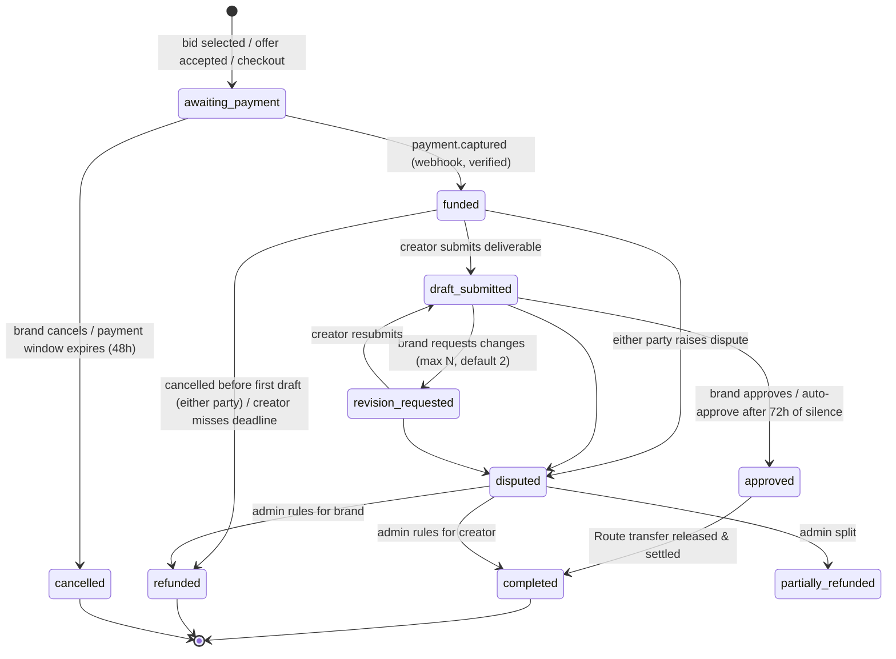

# 02 — System Design

## 1. Actors and roles

| Role | Created by | Can |
|------|-----------|-----|
| `brand` | Self-signup | Discover creators, manage campaigns, send offers, select bids, pay, approve, review |
| `creator` | Self-signup (requires admin approval before bidding or receiving offers) or admin-created catalogue profile | Manage profile/packages, bid, accept offers, deliver, get paid |
| `admin` | **Internal CLI only** (`python manage.py grant_admin <email>`), 2FA required | Approve creators, resolve disputes, refunds, payouts, deactivate users (via the hardened Django admin in v1) |

A user has exactly one role in v1 (open question: can a person be both brand and creator? See doc 09).

Admin-created creator profiles (the "initial catalogue") have `user_id = NULL` until the real creator **claims** the profile through a verified flow (email/phone match plus admin confirmation).

## 2. Modules and ownership

| Module | Owns tables | Publishes events |
|--------|-------------|------------------|
| identity | users, admin_mfa, audit_logs | `user.created`, `user.deactivated` |
| creators | creators, creator_media, creator_packages, social_accounts, payout_accounts | `creator.approved`, `creator.updated` |
| brands | brands, lists, list_items, cart_items | |
| discovery | (read model) creator_search view/index | |
| campaigns | campaigns, bids | `bid.created`, `bid.selected` |
| offers | offers | `offer.created`, `offer.accepted`, `offer.rejected` |
| orders | orders, order_events, deliverables, disputes | `order.*` |
| payments | payments, transfers, refunds, ledger_entries, webhook_events | `payment.captured`, `payout.released`, `refund.processed` |
| tax | invoices, tds_records, fee_configs | `invoice.generated` |
| reviews | reviews | `review.created` |
| messaging | conversations, conversation_participants, messages | `message.created` |
| notifications | notifications, push_subscriptions | |
| reporting | materialized views | |
| admin | (uses other modules' services) | |

## 3. Core flows

### 3.1 Campaign → bid → order

```mermaid
sequenceDiagram
  actor Brand
  actor Creator
  participant API
  Brand->>API: POST /campaigns (brief, budget, usageRights, closesAt)
  Creator->>API: GET /campaigns?status=open (approved creators only)
  Creator->>API: POST /campaigns/:id/bids (price, message, deliveryDays)
  Note over API: unique(campaign_id, creator_id); campaign must be open and not closed
  API-->>Brand: notification new_bid
  Creator->>API: PATCH /campaigns/:id/bids/:bidId (only while status=pending)
  Brand->>API: POST /campaigns/:id/bids/:bidId/select
  Note over API: TX: lock bid → bid.status=selected → create order(awaiting_payment)<br/>snapshot price, usageRights, fee config
  API-->>Creator: notification bid_selected
```

### 3.2 Direct offer → order

Brand `POST /offers` → creator `PATCH /creators/me/offers/:id {status}`. Accepting creates an order in `awaiting_payment` (same transaction). Offers expire automatically at `deadline` or after N days (cron).

### 3.3 Cart (packages)

The brand adds creator packages to the cart, then checks out, which creates one order per package. **The price is read from the package at checkout, never from the cart payload.**

### 3.4 Order lifecycle (state machine)



Implementation rules:
- A single `OrderStateMachine` (`apps/orders/state_machine.py`) holds a **transition table**: `(from, event, actor_role) → to`, plus guards. Any transition not in the table raises `InvalidTransition` → `409 ORDER_INVALID_TRANSITION`.
- Every transition runs as:
  ```python
  with transaction.atomic():
      order = Order.objects.select_for_update().get(pk=order_id)
      OrderStateMachine.transition(order, event, actor)  # validates, sets status, bumps version
      OrderEvent.objects.create(...)                       # who, from, to, reason
      OutboxEvent.objects.create(type=f"order.{event}", ...)
  ```
- **Nobody sets `order.status` directly.** A test asserts that `status` is only assigned inside `state_machine.py` (grep check in CI).
- Time-based transitions (auto-approve, payment expiry, deadline breach) are Celery beat tasks that call **the same** state machine with `actor = system`.
- Reviews are allowed only when `status = completed` and only once per order (`unique(order_id)`).

### 3.5 Deliverables and revisions

- `POST /orders/:id/deliverables` (creator) creates deliverable version `n+1`.
- `POST /orders/:id/revisions` (brand) takes `{ feedback }` and increments `revision_count`. It is rejected once the max is reached (the brand must approve or dispute).
- `contentUrl` is stored as a string and shown as a link. **The server never fetches it** (SSRF). Only `https:` is allowed, with optional host allowlisting (drive.google.com, dropbox.com, instagram.com, youtube.com, our own storage).
- Optional: creators upload drafts to our private bucket instead (presigned). Brands view them via short-lived signed URLs.

### 3.6 Payments

See [04-payments-and-tax.md](04-payments-and-tax.md) for the full escrow design.

## 4. Messaging

- **Who can talk:** default rule (pending confirmation) is that a conversation opens only once a bid, offer, or order exists between the brand and the creator. This limits spam and taking deals off the platform.
- **Write path:** `POST /conversations/:id/messages` → check membership → insert message (atomic + outbox) → Celery handler calls `channel_layer.group_send("conv_<id>", ...)` → the Channels consumer on every instance pushes to connected members.
- **Consumer:** `MessagingConsumer(AsyncJsonWebsocketConsumer)`. Clients only receive; sending goes through REST so validation, throttling, and persistence stay in one place.
- **Read path:** cursor pagination by `(created_at, id)`. Unread counts come from `conversation_participants.last_read_message_id`.
- **Realtime auth:** the client calls `POST /realtime/ticket`, which returns a single-use ticket (30s TTL, stored in Redis), and connects to `wss://api…/ws/?ticket=…`. A custom Channels auth middleware consumes the ticket (Redis `GETDEL`), so it can't be replayed. **JWTs are never put in the WS URL**, because query strings end up in logs. Validate the `Origin` header (`AllowedHostsOriginValidator`). On join, the server checks membership for every group.
- **Limits:** 4,000 chars per message; 30 messages/min per user; attachments via presigned upload to the private bucket.
- **Safety:** stored as plain text; frontends render it as text (never as HTML). Optional later: phone/email pattern detection to nudge users against off-platform deals.

## 5. Notifications

One consumer per event type maps the domain event to recipients, then:
1. Insert an in-app `notifications` row (unique on `(event_id, user_id)`, so it's idempotent).
2. Publish to the user's WS room `user:{id}`.
3. Web push to each `push_subscriptions` row (VAPID). Subscriptions that return 404/410 are deleted.
4. Email for key events, respecting user preferences, via the email queue (with retries).

Types: `new_bid | bid_selected | offer_received | offer_accepted | deliverable_submitted | revision_requested | order_approved | payment_released | order_cancelled | dispute_opened | new_message` (`new_message` is batched/debounced for push and email).

## 6. Discovery and search

- v1: Postgres full-text search via `django.contrib.postgres` (`SearchVectorField` on name, bio, category, location, kept updated by a trigger or on save) + `TrigramSimilarity` for fuzzy names + filters (category, location, platform, follower range, price range, rating). Served from the **read replica**.
- Only `approved` + active creators are returned.
- Cursor pagination with a hard page-size cap (max 50).
- Scale path: when the catalogue exceeds about 200k creators or ranking gets complex, move to **Typesense/Meilisearch/OpenSearch**, fed from the outbox (`creator.updated` → reindex).

## 7. Social account sync

- OAuth runs **on the server**: `GET /creators/me/social/:platform/connect` returns an authorize URL with `state` (CSRF) + PKCE. `GET /creators/me/social/:platform/callback` exchanges the code on the server.
- Instagram requires a Business or Creator account through the **Instagram Graph API** (Basic Display was shut down Dec 2024), and Meta App Review. YouTube uses Google OAuth + YouTube Data API (read-only scope).
- Tokens are **encrypted at rest** (AES-256-GCM, key from secret manager) and refreshed by cron before expiry.
- A daily worker job pulls followers and engagement per account, with per-provider rate-limit budgets and backoff. Results are stored as snapshots (`social_stats_daily`) for trends.
- Self-reported follower counts are never trusted for ranking. Only verified numbers get the "verified" badge.

## 8. Background jobs

| Job | Trigger | Notes |
|-----|---------|-------|
| relay_outbox | Celery beat, every 2–5s | `select_for_update(skip_locked=True)` batches |
| notifications / email / push | events | retries with exponential backoff, DLQ |
| razorpay-webhook-processor | webhook enqueue | idempotent on event id |
| payout-release | `order.approved` | releases the Route transfer hold |
| auto-approve | cron every 15 min | orders in `draft_submitted` > 72h |
| payment-expiry | cron every 15 min | `awaiting_payment` > 48h → cancelled |
| deadline-breach | cron hourly | notify, allow brand cancel/refund |
| offer/campaign-expiry | cron hourly | close past `closes_at` / `deadline` |
| social-sync | cron daily + on connect | token refresh, stats |
| reconciliation | cron daily | our ledger vs Razorpay payments, transfers, settlements |
| invoice-generation | `order.completed` | PDF → private bucket |
| image-processing | upload-complete | validate, strip EXIF, resize, WebP |
| search-reindex | `creator.updated` | when external search is introduced |

All jobs are **idempotent** (keyed by entity id + action) and use `acks_late=True` + `autoretry_for` with exponential backoff and `max_retries`. Final failures are recorded in a `FailedTask` table (our dead-letter queue), visible in the Django admin, and they alert. Pass **ids** to tasks, never model instances, and re-read state inside the task.

## 9. Concurrency and consistency rules

- Money and state transitions use **pessimistic row locks** (`select_for_update()` inside `transaction.atomic()`), kept short. **No external HTTP calls (Razorpay etc.) while holding a lock.** Call the provider first or after, and make the step idempotent.
- `ATOMIC_REQUESTS = False`. Transactions are explicit in services.
- Profile edits and similar updates use **optimistic locking** (a `version` field: `filter(pk=…, version=v).update(..., version=F('version')+1)`; 0 rows → `409`).
- Uniqueness is enforced **in the DB**, not just in code: one bid per creator per campaign, one review per order, unique Razorpay ids, unique webhook event ids.
- Mutating money endpoints (`/payment-intent`, `/pay`, `/approve`, `/cancel`, `/refund`, `/payouts/:id/process`) require an **`Idempotency-Key`** header. Responses are cached for 24h per `(user, key)`.
