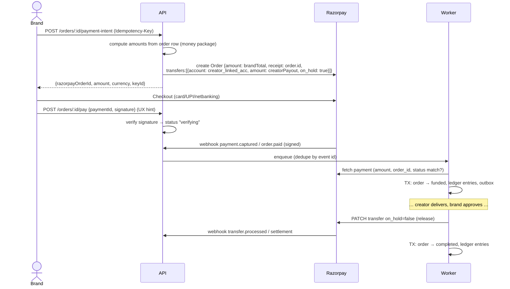

# 04 — Payments, Escrow, and Tax

> ⚠️ **Two things must be confirmed before building payments:**
> 1. **With Razorpay:** that our hold-and-release model on **Razorpay Route** (or their Escrow product) is approved for our business. Holding customer money in our own current account and paying out later can make us a payment aggregator under RBI rules, which we must avoid.
> 2. **With a CA:** the GST and TDS treatment (which section, rates, who bears commission, TCS obligations). All rates live in **config**, never in code, so the CA's answer won't need a code change.

## 1. Escrow model on Razorpay Route

- Every creator who can receive money has a **Razorpay linked account** (Route). Razorpay does KYC and stores bank details. Creator payout onboarding = `POST /creators/me/payout-account` → we create the linked account + stakeholder + product config → KYC status comes back by webhook.
- A creator **cannot accept an offer or have a bid selected** until the linked account is `activated` (or we allow it but block funding until then; decide in doc 09).



Cancel/refund before release: **reverse the transfer** (`POST /transfers/:id/reversals`) → **refund the payment** (`POST /payments/:id/refund`, full or partial) → order `refunded` / `partially_refunded`, ledger entries.

Notes:
- Store `razorpay_order_id`, `payment_id`, `transfer_id`, `refund_id` with **unique constraints**.
- `keyId` (publishable) is fine to return. **`key_secret` and the webhook secret never leave the server.**
- Webhook events to subscribe to: `payment.captured`, `payment.failed`, `order.paid`, `refund.processed`, `refund.failed`, `transfer.processed`, `transfer.failed`, `account.activated` / KYC-related events, `settlement.processed`.
- **Kill switch:** env/config flag `PAYOUTS_FROZEN` stops all releases (incident response).

## 2. Ledger (double-entry, append-only)

Every money movement writes **balanced** entries (sum of debits = sum of credits per transaction). Rows are never updated or deleted; corrections are new reversing entries.

Accounts: `brand_payments` · `escrow_held` · `creator_payable` · `platform_revenue` · `gst_payable` · `tds_payable` · `refunds_payable` · `gateway_fees`.

Example (₹10,000 order, illustrative numbers):

| Event | Debit | Credit | Amount |
|-------|-------|--------|--------|
| payment captured | brand_payments | escrow_held | 11,180 |
| order approved | escrow_held | creator_payable | 9,000 |
| | escrow_held | platform_revenue | 1,000 |
| | escrow_held | gst_payable | 180 |
| | escrow_held | tds_payable | 1,000 *(rate TBD)* |

The daily **reconciliation job** compares ledger totals with Razorpay payments, transfers, refunds, and settlements, and pages on any mismatch.

## 3. Money math

- **All amounts are integers in paise** (`BigIntegerField`, suffix `_paise`). **Never `float`.** For percentage math, use `Decimal` with `ROUND_HALF_UP`, then convert back to `int` paise. The API returns `{ "amount": 1118000, "currency": "INR" }`.
- Lives in `backend/apps/money/` as pure functions (no Django imports, frozen dataclasses), with 100% test coverage plus property-based tests (`hypothesis`) asserting `brand_total == creator_payout + platform_fee + gst + tds` for every input.
- Fee config is **versioned** (`fee_configs` table: commission %, GST %, TDS %, TDS section, who bears commission, effective_from). **Each order snapshots the config it was created with**, so later rate changes never alter existing orders.

### Correction to the original spec's numbers

The spec example was internally inconsistent: GST 1,800 is 18% of the **subtotal**, not of the 1,000 fee, and `creatorPayout` ignored commission. Corrected, assuming **the brand pays commission + GST on commission, and the creator bears TDS**:

```
subtotal          10,000   (creator's price)
platformFee        1,000   (10% commission, charged to brand)
gstOnFee             180   (18% of platformFee)
brandTotal        11,180   (subtotal + platformFee + gstOnFee)
tdsDeducted          ???   (rate & section per CA, applied to creator's amount)
creatorPayout     10,000 − tdsDeducted
```

If instead commission is deducted from the creator: `brandTotal = 10,000 + GST as applicable`, `creatorPayout = 10,000 − 1,000 − TDS`. **This is a business decision, see doc 09.**

## 4. Tax notes for the CA conversation (not legal advice)

- **TDS section:** the spec says 194J (professional/technical fees). Marketplaces that collect payment on behalf of sellers may fall under **194-O (e-commerce operator)**, which has a much lower rate. Influencer arrangements may also touch **194R** (perquisites, e.g. free products). The CA must decide.
- **GST:** we charge GST on our platform fee. Check if we must collect **TCS under GST section 52** as an e-commerce operator, and how GST-registered creators invoice brands (does the creator charge GST on their fee?).
- **Invoices:** GST invoices need a **sequential, unique number per financial year** (≤ 16 chars, e.g. `INV/2627/000123`). Generate it via a per-FY counter row locked with `FOR UPDATE`, not a random id. Store immutable PDFs in the private bucket plus the data used to render them.
- **TDS certificates:** official Form 16A comes from TRACES after filing. What we can generate is a **TDS statement/summary**; the endpoint should be named accordingly unless the CA advises otherwise.
- Brand and creator GSTIN and PAN validated by format (and optionally via a GST verification API).

## 5. Failure handling

| Failure | Handling |
|---------|----------|
| Client paid but `/pay` never called | Webhook still funds the order |
| Webhook delivered twice | Unique `event_id` → second is a no-op |
| Webhook missing / delayed | Reconciliation cron fetches Razorpay orders stuck in `awaiting_payment` with an attempted payment |
| Amount mismatch on capture | Do **not** fund; flag for admin; auto-refund |
| Transfer release fails | Retry with backoff; after N tries, alert + admin payout queue |
| Refund fails | `refund.failed` → retry → admin queue |
| Creator KYC not active at release | Hold; notify creator; admin queue |
