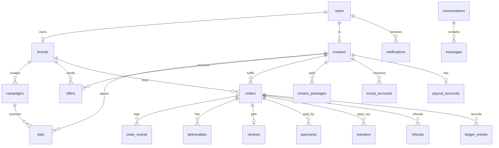

# 05 — Data Model

Conventions (Django):
- All tables in Postgres schema `app` (via `search_path`). Every model extends `core.BaseModel`: `id = UUIDField(primary_key=True, default=uuid7)` (Python 3.14 `uuid.uuid7` or the `uuid6` package on 3.13), `created_at`, `updated_at`.
- **Custom user model** `identity.User` (`AUTH_USER_MODEL`) is created before the first migration. App users have `supabase_uid` and an unusable password; staff use Django passwords + TOTP.
- Money: `BigIntegerField`, suffix `_paise`. Never `FloatField`.
- Enums: `models.TextChoices` + a `CheckConstraint` so the DB also enforces valid values.
- Uniqueness and invariants as `Meta.constraints` (`UniqueConstraint`, including conditional ones, and `CheckConstraint`), **not only** in code.
- Soft delete via `deleted_at` only where needed (users, creators, campaigns). Financial tables are **never** deleted: `on_delete=PROTECT` on every FK pointing at orders, payments, or ledger.
- Every FK is indexed (Django does this). Add composite `Meta.indexes` for authz/list queries as listed below.

## Identity

| Table | Key columns | Constraints / notes |
|-------|-------------|---------------------|
| `users` (`identity.User`, custom `AbstractBaseUser`) | supabase_uid (null for staff), email, phone, role, status, is_staff, terms_version, last_login, deleted_at | unique(supabase_uid) where not null; role ∈ brand/creator/admin; status ∈ active/suspended/deactivated |
| `audit_logs` | actor_user_id, action, entity_type, entity_id, before jsonb, after jsonb, ip, user_agent | append-only (DB role has no UPDATE/DELETE); index (entity_type, entity_id) |

## Brands

| Table | Key columns | Notes |
|-------|-------------|-------|
| `brands` | owner_user_id, name, logo_url, gstin, legal_name, billing_address jsonb, state_code | GSTIN format CHECK; state_code for CGST/SGST vs IGST |
| `brand_members` *(if teams)* | brand_id, user_id, role (owner/manager/viewer) | unique(brand_id, user_id) |
| `lists`, `list_items` | brand_id, name / list_id, creator_id | unique(list_id, creator_id) |
| `cart_items` | brand_id, package_id, qty | price read from the package at checkout |

## Creators

| Table | Key columns | Notes |
|-------|-------------|-------|
| `creators` | user_id (nullable for catalogue), slug, display_name, bio, categories text[], location, primary_platform, replies_within, approval_status, verified, rating_avg, rating_count, search_tsv tsvector | unique(slug); GIN(search_tsv); GIN(categories); trigram(display_name); approval_status ∈ pending/approved/rejected |
| `creator_media` | creator_id, kind (avatar/gallery), storage_key, width, height, status (processing/ready/rejected), sort | |
| `creator_packages` | creator_id, title, deliverables, platform, price_paise, delivery_days, active, version | CHECK price_paise > 0 |
| `social_accounts` | creator_id, platform, external_id, handle, followers, engagement_rate, token_ciphertext bytea, token_key_version, token_expires_at, last_synced_at, status | unique(platform, external_id) — one IG account can't be claimed by two creators |
| `social_stats_daily` | social_account_id, date, followers, avg_views, engagement_rate | PK(social_account_id, date) |
| `payout_accounts` | creator_id, razorpay_linked_account_id, kyc_status, pan_last4, pan_ciphertext (if required), gstin, bank_changed_at | unique(creator_id) |

## Marketplace

| Table | Key columns | Notes |
|-------|-------------|-------|
| `campaigns` | brand_id, title, brief, platform, deliverables, budget_min_paise, budget_max_paise, closes_at, status, usage_rights jsonb | status ∈ draft/open/closed/cancelled; CHECK min ≤ max; index (status, closes_at) |
| `bids` | campaign_id, creator_id, price_paise, message, expected_views, delivery_days, status, version | unique(campaign_id, creator_id); status ∈ pending/selected/rejected/withdrawn |
| `offers` | brand_id, creator_id, deliverable, budget_paise, deadline, message, usage_rights jsonb, status, expires_at | status ∈ pending/accepted/rejected/expired/withdrawn |

`usage_rights` JSON schema (validated by a nested DRF serializer + a `CheckConstraint` on required keys): `{ duration: "perpetual"|"12m"|"6m"|"3m", channels: ("paid_ads"|"organic_social"|"website")[], exclusivity: boolean, exclusivityCategory?: string, territory: string }`.

## Orders

| Table | Key columns | Notes |
|-------|-------------|-------|
| `orders` | brand_id, creator_id, source_type (bid/offer/package), source_id, status, version, deadline, revision_count, max_revisions, usage_rights jsonb (snapshot), fee_config_snapshot jsonb, subtotal_paise, platform_fee_paise, gst_paise, tds_paise, creator_payout_paise, brand_total_paise, funded_at, approved_at, completed_at | unique(source_type, source_id) — one order per bid/offer; index (brand_id, status), (creator_id, status), (status, updated_at) for crons |
| `order_events` | order_id, from_status, to_status, event, actor_user_id, actor_role, reason, metadata | append-only history |
| `deliverables` | order_id, version, content_url, storage_key, note, submitted_at, review_status, feedback | unique(order_id, version) |
| `disputes` | order_id, opened_by, reason, status, resolution, resolved_by, resolved_at | one open dispute per order (partial unique index) |
| `reviews` | order_id, brand_id, creator_id, stars, text | unique(order_id); CHECK stars 1–5 |

## Payments & tax

| Table | Key columns | Notes |
|-------|-------------|-------|
| `fee_configs` | commission_bps, gst_bps, tds_bps, tds_section, commission_bearer, effective_from | basis points (1% = 100) |
| `payments` | order_id, razorpay_order_id, razorpay_payment_id, amount_paise, status, method | unique(razorpay_order_id), unique(razorpay_payment_id) |
| `transfers` | order_id, razorpay_transfer_id, linked_account_id, amount_paise, on_hold, status, released_at | unique(razorpay_transfer_id) |
| `refunds` | order_id, payment_id, razorpay_refund_id, amount_paise, reason, status, initiated_by | unique(razorpay_refund_id) |
| `ledger_entries` | txn_id, account, direction (debit/credit), amount_paise, order_id, ref_type, ref_id | append-only; DB trigger or deferred check that each txn_id balances |
| `webhook_events` | provider, event_id, event_type, payload jsonb, signature_valid, status, processed_at, error | unique(provider, event_id) |
| `invoices` | order_id, number, fy, kind (brand_fee_invoice/…), storage_key, data jsonb | unique(number) |
| `invoice_counters` | fy, prefix, next_value | locked FOR UPDATE when issuing |
| `tds_records` | order_id, creator_id, section, rate_bps, amount_paise, quarter, deposited_at, challan_ref | |
| `idempotency_keys` | user_id, key, request_hash, response jsonb, status, expires_at | PK(user_id, key); a different request_hash for the same key → 422 |

## Messaging & notifications

| Table | Key columns | Notes |
|-------|-------------|-------|
| `conversations` | brand_id, creator_id, last_message_at, context_type, context_id | unique(brand_id, creator_id) |
| `conversation_participants` | conversation_id, user_id, last_read_message_id, muted | PK(conversation_id, user_id) |
| `messages` | conversation_id, sender_user_id, body, attachment_key, created_at | index (conversation_id, created_at desc, id); partition by month when large |
| `notifications` | user_id, type, title, body, data jsonb, read_at, event_id | unique(event_id, user_id); index (user_id, created_at desc) where read_at is null |
| `push_subscriptions` | user_id, endpoint, p256dh, auth, user_agent, last_used_at | unique(endpoint) |
| `notification_prefs` | user_id, channel, type, enabled | |

## Infra tables

| Table | Notes |
|-------|-------|
| `outbox_events` | id, aggregate_type, aggregate_id, type, payload, created_at, published_at; index where published_at is null |
| `realtime_tickets` | (Redis, not Postgres) single-use, 30s TTL |

## ER overview

